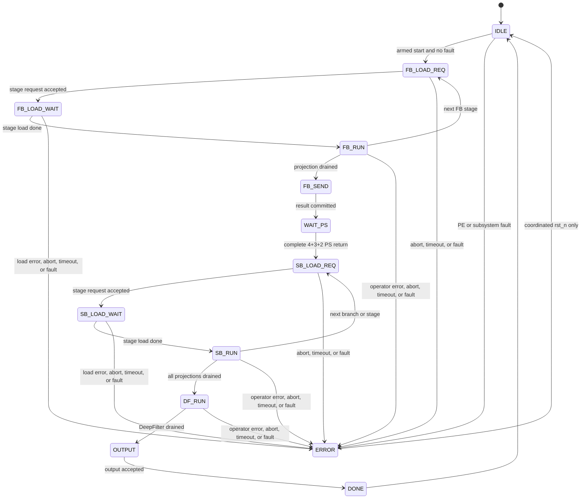

# Sequential v4 global FSM and subband scheduling

## Result

The production controller is implemented in `rtl/control/fsm.v`.  The existing
13-state stage scheduler was retained because its shared-engine ordering already
matches the connected Sequential v4 subsystem.  The production mode is one
time-multiplexed PE array and memory bank (`parallel_subbands=0`).  The legacy
three-engine control path remains only as a simulation-compatible experiment;
the current frozen subsystem rejects nonzero stage banks and exposes only PE
engine 0, so a production top must tie the mode low.

This module is control only.  It does not issue per-cycle PE micro-operations.
The frozen `sequential_pe_job_controller` owns that protocol inside
`sequential_v4_pe_memory_subsystem`; `fsm.v` owns frame/stage lifecycle through
stage request, job request, barrier, completion, abort, and fault signals.
`accelerator_top`, mailbox adapters, external AXI DMA, DeepFilter data routing,
final-output plumbing, reset coordination, and clock-domain crossing remain to
be implemented.

The byte-level PE/memory boundary is frozen by
`docs/frozen/PE_MEMORY_V4_FREEZE.md`.  `fsm.v` is intentionally outside that
freeze.

## Production hierarchy

The architecture sketch is interpreted as the following implementable control
hierarchy.  In particular, the green FSM-to-PE arrow is not a direct PE opcode
bus; it terminates at the Sequential v4 subsystem controller.

```text
PYNQ PS CPU
  | control/status (future AXI-Lite or mailbox adapter)
  v
global fsm.v                         layernorm_mailbox (future connection)
  | stage_req / job valid-ready / barrier / fault / abort
  v
sequential_v4_pe_memory_subsystem    <---- custom AXI read data from PS DDR
  |-- memory_service + 256 KiB stage cache
  |-- sequential_recurrent_context_store
  |-- sequential_pe_job_controller
  `-- pe_array_datapath (frozen baseline/v1 top)
```



## Difference from the previous FSM checkpoint

| Topic | Previous checkpoint | Sequential v4 production rule |
| --- | --- | --- |
| Stage schedule | 13 states, 12 stage IDs, 4/3/2 subband contexts | Retained; the connected v4 test already proves this ordering |
| FSM-to-PE boundary | Could be read as direct PE control | FSM controls subsystem jobs; frozen job controller owns PE microcycles |
| PE/memory mutability | Shared compile manifest included the FSM | PE/memory have a separate 25-file frozen checksum; FSM is excluded |
| Fault recovery | `clear_error` returned directly to `IDLE` | Fatal state is reset-only to match v4 `reset_required`; `clear_error` is ignored |
| Start request | Level-sensitive in `IDLE` | One-shot armed; a held-high PS request cannot start a second frame |
| Fault present before start | Fault was checked only while `busy` | Any non-error state, including `IDLE`, enters `ERR_PE` and blocks start |
| Subband parallelism | Shared and three-engine modes appeared equivalent | Only shared engine/bank 0 is production; three-engine control is compatibility-only |
| Board claim | FSM and old artifacts could be considered separately | A v4 board run requires a new top/BD/bitstream; old v3 BIT must not be programmed as v4 evidence |

## Frame flow

```text
start
  -> load/run FB GSU1       stage 0
  -> load/run FB GSU2       stage 1
  -> load/run FB projection stage 2
  -> publish 64-element result in a mailbox output slot for PYNQ PS
  -> wait for one complete, frame-matched 782-byte mailbox input commit from PS
  -> load/run SB GSU1       stages 3, 6, 9
  -> load/run SB GSU2       stages 4, 7, 10
  -> load/run SB projection stages 5, 8, 11
  -> DeepFilter
  -> final output handshake
  -> one-cycle done
```

The PS-return handshake means that all nine vectors are already buffered for
PL consumption: four contexts for subband 0, three for subband 1, and two for
subband 2. This atomic contract prevents the FSM from reading a partially
returned frame.

## State definitions

| Code | State | Exit condition / action |
| ---: | --- | --- |
| 0 | `IDLE` | Accept one armed `start` only when no PE fault is present; latch mode and optionally pulse recurrent-state clear |
| 1 | `FB_LOAD_REQ` | Hold the selected fullband stage request until memory accepts it |
| 2 | `FB_LOAD_WAIT` | Wait for load completion; report memory error or queue held `fb_start` |
| 3 | `FB_RUN` | Handshake the job, latch operator completion, wait full PE drain; repeat stages 0, 1, 2 |
| 4 | `FB_SEND` | Hold `fb_result_valid`; future mailbox adapter asserts ready only after accepting the complete result into a free output slot |
| 5 | `WAIT_PS` | Wait for `ps_subbands_valid`; future mailbox adapter generates it only from a complete, frame-matched 4+3+2 input commit |
| 6 | `SB_LOAD_REQ` | Hold one subband stage/bank request until accepted |
| 7 | `SB_LOAD_WAIT` | Load one branch in shared mode or all three branch banks in parallel mode |
| 8 | `SB_RUN` | Handshake jobs, latch independent completion/drain, advance 4/3/2 contexts and repeat GSU1, GSU2, projection |
| 9 | `DF_RUN` | Handshake DeepFilter after all projections, then wait completion and full PE drain |
| 10 | `OUTPUT` | Hold final output valid until accepted |
| 11 | `DONE` | Assert `done` for one cycle, then return to `IDLE` |
| 12 | `ERROR` | Reset-required sticky fault; `clear_error` cannot release it |

Stage counters keep the FSM compact: the three fullband stages and nine
subband branch/stage combinations do not require twelve duplicated control
states. `state_debug` exposes the current code and `state_cycle_count` exposes
time spent in it.

## Stage and bank mapping

| Stage ID | Operator | Shared bank | Parallel bank |
| ---: | --- | ---: | ---: |
| 0 | Fullband GSU1 | 0 | 0 |
| 1 | Fullband GSU2 | 0 | 0 |
| 2 | Fullband projection | 0 | 0 |
| 3 | Subband 0 GSU1 | 0 | 0 |
| 6 | Subband 1 GSU1 | 0 | 1 |
| 9 | Subband 2 GSU1 | 0 | 2 |
| 4 | Subband 0 GSU2 | 0 | 0 |
| 7 | Subband 1 GSU2 | 0 | 1 |
| 10 | Subband 2 GSU2 | 0 | 2 |
| 5 | Subband 0 projection | 0 | 0 |
| 8 | Subband 1 projection | 0 | 1 |
| 11 | Subband 2 projection | 0 | 2 |

The stage-major order allows parallel mode to keep only the current operator
type resident: load three GSU1 banks, run the branches, replace them with three
GSU2 banks, then replace those with three projection banks. It avoids the even
larger cost of keeping every branch stage resident simultaneously.

## Shared-engine schedule

`parallel_subbands=0` selects the baseline. Only `sb_start[0]` is used;
`sb_shared_branch` tells the physical engine whether it is operating on logical
branch 0, 1, or 2. For every subband stage the schedule is:

```text
load SB0 -> run contexts 0..3
load SB1 -> run contexts 0..2
load SB2 -> run contexts 0..1
```

One physical PE array and bank are sufficient. The implementation must retain
each branch's recurrent state and GSU1 intermediate spikes while other branches
use the engine.

## Compatibility-only three-engine schedule

`parallel_subbands=1` is sampled only when `start` is accepted. It assumes
physical engines and banks 0/1/2 map permanently to subbands 0/1/2. For each
stage, the FSM loads the three banks sequentially, pulses `sb_start=3'b111`,
then independently relaunches a branch until its 4/3/2 contexts finish.
Branches that finish early remain idle. The next stage starts only after all
three completion bits are set, and DeepFilter starts only after all three
projection branches finish.

This changes subband compute latency from an approximate sum of branch work to
the maximum branch work. It does not eliminate stage-load time, the PS
round-trip, or the need to provide three independent weight streams.

## Error and handshake contract

| Error code | Meaning |
| ---: | --- |
| 0 | none |
| 1 | external abort |
| 2 | state timeout |
| 3 | memory stage-load error |
| 4 | fullband operator error |
| 5 | any active subband operator error |
| 6 | DeepFilter error |
| 7 | illegal/internal FSM state |
| 8 | formal PE protocol or arithmetic fault |

`fb_start`, `sb_start`, and `df_start` are held valid until the corresponding
`*_start_ready` accepts the job. `clear_state_pulse` remains a one-cycle event.
An operator `done` event is latched; the FSM does not cross the stage boundary
until the corresponding `pe_barrier_idle` proves the complete PE subsystem and
external writeback are drained. `pe_fault` is checked even in `IDLE`; it enters
sticky `ERROR` and generates `pe_abort_pulse` so a pre-existing subsystem fault
cannot be hidden by a new frame request.

Stage and final-output interfaces use ready/valid semantics. The current FSM
exposes `fb_result_valid/ready` and `ps_subbands_valid`; the future production
mailbox adapter must translate its persistent slot ownership into those
signals. It may accept `FB_SEND` only after storing all 64 output bytes, and may
assert `ps_subbands_valid` only after the expected frame ID atomically commits
all 782 input bytes. Load/operator completion must follow its request; all
events entering the FSM must already be synchronous to `clk`. `abort`, timeout,
and subsystem faults take the FSM to sticky `ERROR`. Sequential v4 fatal state
is reset-only, therefore `clear_error` is retained solely for source-level ABI
compatibility and is ignored by the controller. A future top must perform one
coordinated reset of FSM, subsystem, mailbox ownership, and adapters before
accepting another frame. The exact formal-PE wiring is defined in
`docs/PE_ARRAY_FSM_INTEGRATION.md`.

`start` is edge-armed internally: one high assertion can start only one frame.
Software may hold it high while waiting for `busy`; it must drive it low once
to re-arm a later frame.

## PYNQ-Z1 feasibility assessment

Repository target resources are 53,200 LUT, 106,400 FF, 220 DSP48E1, and 140
BRAM36. Evidence and estimates must be kept separate:

| Item | Evidence | Result |
| --- | --- | --- |
| FSM only, current v4 contract | Vivado 2018.3 OOC, `xc7z020clg400-1`, 10 ns | 163 LUT, 80 FF, 0 DSP, 0 BRAM, WNS +4.135 ns |
| Shared schedule | RTL control behavior + structural analysis | PYNQ baseline; one PE/bank, complete integrated resources and RTF still unknown |
| Three-engine control | XSim behavior | Correct control ordering only; does not prove board fit |
| Three GSU1 raw banks | Analytical, `ceil(stage_bytes/4096)` per 64-bit BRAM36 | about 83 BRAM36 |
| Three GSU2 raw banks | Same analytical mapping | about 102 BRAM36 (72.9% of board BRAM) |
| Three projection raw banks | Same analytical mapping | about 25 BRAM36 |
| All three full branches resident | Same analytical mapping | about 210 BRAM36; does not fit |

The current 4-lane Local Requant Bank uses 16 DSP, so three copies alone would
use 48 DSP before Hybrid PEs, gates, membrane operations, DeepFilter, and other
logic. That number is not a complete three-engine estimate. A single 64-bit
memory port also cannot supply three independent 128-bit requests in one cycle.

Parallel mode may become an integration option only after all of these gates:

1. one complete subband engine has representative OOC synthesis;
2. three intended engine instances plus all shared logic retain resource margin;
3. three weight banks/ports or a measured multi-client cache meet bandwidth;
4. implementation closes timing on `xc7z020clg400-1`;
5. board measurements show a frame-latency/RTF benefit over shared mode.

Until then, `accelerator_top` must tie `parallel_subbands` low. Two-way parallelism or a
smaller active-source/tile cache is the preferred fallback if profiling shows
that one engine cannot meet real-time requirements.

## Verification

`tb_fsm` is self-checking. It verifies exact 12-stage order, bank selection,
three fullband starts, 27 subband context/stage commands, unequal compatibility
mode latencies, held job-valid backpressure, delayed PE drain, PL/PS and final
output backpressure, mid-frame reset, abort, timeout, reset-only error behavior,
IDLE fault blocking, held-high `start` non-retrigger, and injected operator and
memory faults. The current 2026-09-05 Vivado 2018.3 run completed at 10,036 ns
with `PASS tb_fsm`.

The real v4 image plus frozen PE/memory connected harness also passed after the
controller change: 2,385,005 checks, 24 stage accepts, 6 fullband jobs, 54
subband jobs, and 101,446 sparse requests across two frames. The independent
subsystem harness remained at 2,551,777 checks PASS. The frozen 25-file
PE/memory checksum and the PE archive's 158-entry checksum both passed.

The repository-wide runner was not rerun because its existing Windows
PowerShell preflight could not resolve `Get-FileHash`; the targeted current FSM
and connected subsystem simulations above used direct Vivado 2018.3 commands.
The older 2026-09-03 full regression remains 25/25 PASS evidence for that older
source snapshot, not a current full-regression claim.

Vivado Hardware Manager detected one Digilent JTAG target with `arm_dap_0` and
`xc7z020_1` (`PART=xc7z020`). No PL programming was attempted because the repo
does not yet contain a production accelerator top or v4-compatible bitstream.

This is current simulation, checksum, FSM-only synthesis, and JTAG enumeration
evidence. It is not full-system implementation, programmed-board function,
board timing, bandwidth, RTF, power, or audio-quality evidence.
