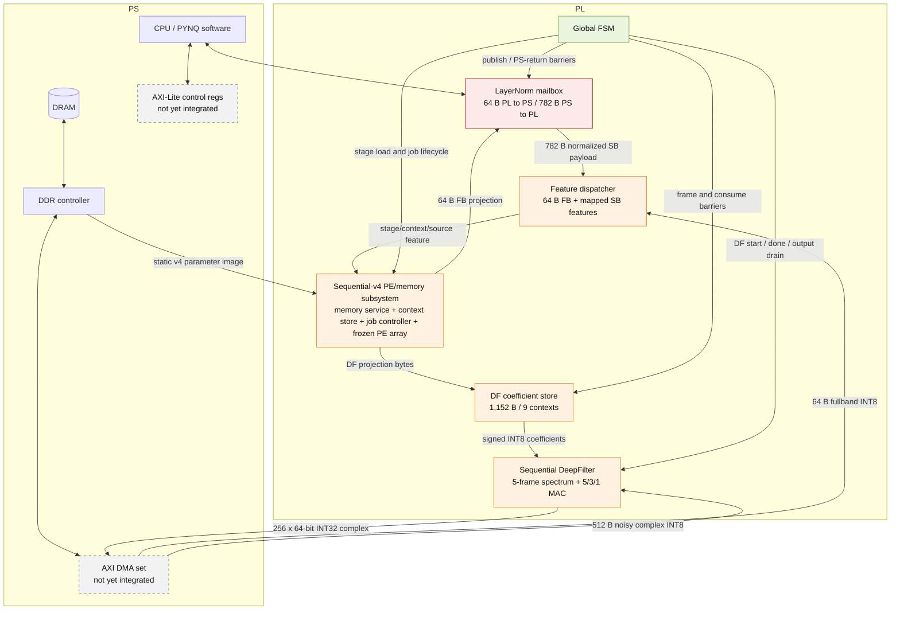
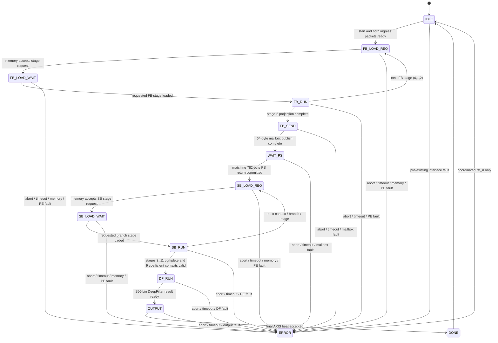

# Production accelerator runtime architecture

Date: 2026-09-06 (Asia/Taipei)

Status: RTL datapath through DeepFilter is implemented and unit-tested.  PS7,
DMA, AXI-Lite control, reset/CDC block-design wiring, and bitstream are pending.

## System blocks and links

Orange paths carry model operands/results, red is the PS LayerNorm round trip,
and green is lifecycle/control.  The FSM never carries payload bytes.

## Differences from the supplied conceptual diagram

| Conceptual diagram | Current production RTL |
|---|---|
| PE array and sequential-v4 memory are independent peers | They are frozen inside one `sequential_v4_pe_memory_subsystem`, together with the job controller and recurrent-context store. |
| DDR connects generically to model input/output/weight | Static v4 parameters use the custom read-only AXI master; fullband input, noisy spectrum, and final results require separate AXI DMA paths. |
| PS mailbox connects broadly to the PE array | The mailbox is restricted to the LayerNorm ABI: 64-byte fullband projection to PS and 782-byte normalized subband payload back to PL. |
| FSM connects directly to memory and PE | It commands the subsystem at stage/job barriers; feature and coefficient bytes pass through dedicated dispatcher/store blocks. |
| DeepFilter is not shown | A 1,152-byte coefficient store and a five-frame sequential DeepFilter engine now sit after subband projection. |

## Global FSM states

The physical stage order in shared-engine production mode is
`0,1,2,3,6,9,4,7,10,5,8,11`.  States are barriers, not one-cycle pulses:
valid/start signals remain asserted until the corresponding ready handshake,
and completion is not retired until the PE boundary is idle.

## Pre-programming gate

The full RTL top routes with zero routing errors and zero unconstrained
internal endpoints, but 100 MHz routed-OOC WNS is `-0.467 ns`.  The worst path
is inside the frozen recurrent-context store.  Before PS7/DMA block-design
implementation, the team must choose one of two production directions:

1. keep 100 MHz and explicitly unfreeze/pipeline the recurrent-context error
   path; or
2. keep all frozen bytes and select a lower FCLK with new timing/throughput
   acceptance criteria.

No bitstream should be generated or programmed until that decision and the
subsequent full block-design timing/CDC/DRC gate pass.
