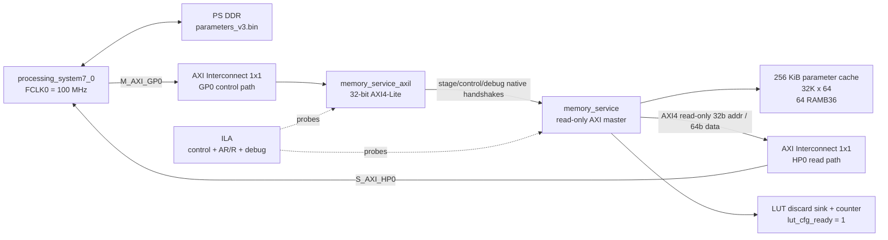

# Parameter BRAM 板上 bring-up 設計與驗證計畫

- Checkpoint：已產生最小 `PS DDR -> memory_service -> parameter BRAM -> PS readback`
  的可追溯BIT/HWH/LTX；第一次Stage 2實板smoke因缺明確PYNQ-Z1連線endpoint而
  在program前**BLOCKED**
- 目標板／器件：PYNQ-Z1／`xc7z020clg400-1`
- 目標 clock：100 MHz，單一 PL clock domain
- 文件狀態：ABI contract frozen；AXI-Lite wrapper、bring-up top、real-v3 TB、
  BD Tcl、Stage-2-only PYNQ driver、full-BD implementation及hardware artifacts
  已完成；實板路徑尚未執行
- 證據等級：Python 20/20、Windows Vivado 2018.3 XSim保存證據、fresh BD
  validation/post-route及matching BIT/HWH/LTX；artifact sub-gate PASS，combined
  board checkpoint為**BLOCKED**，沒有program/MMIO/DDR/readback板測結果

本 checkpoint 只固定 parameter cache 的第一條實板驗證路徑。LayerNorm mailbox、
external AXI DMA、PE/FSM 與推論資料流全部不接入，且不修改 `upstream/`。

## 0. 2026-09-03 Stage 2 artifact／board checkpoint

Windows Vivado 2018.3從新的`%TEMP%` project，以hardware source commit
`78c86f38f7c8f227bc2d032f5e2ef59ae4935d3e`重建PYNQ-Z1 BD並重新route。最終
setup WNS/TNS為+0.964/0.000 ns、hold WHS/THS為+0.019/0.000 ns，0 failing
endpoints、0 unrouted nets、0 blocking DRC；之後成功執行`write_bitstream`並由同一
project匯出同basename HWH與LTX。三個binary放在可重建且Git忽略的`rtl/build/`
目錄，hash、build metadata及關鍵report保存於
`rtl/reports/parameter_bram_board_stage2/`。

板端部分依安全gate停止：本次prompt與repository均沒有明確標示為PYNQ-Z1的連線
endpoint，environment／SSH設定也沒有具名PYNQ alias。未掃描網路、未猜IP／帳密、
未連線、未program PL，也未執行board driver。因此HW ID/ABI、Stage 2 counters、5筆
readback與release/cleanup都仍是**NOT ACQUIRED**；結論是`BLOCKED`而不是板測FAIL。
Stage 1仍不允許執行。

## 1. 既有基礎盤點

| 項目 | 本 checkpoint 已落實／可重用部分 | 仍缺少的部分 |
| --- | --- | --- |
| PYNQ-Z1 規劃基準 | `create_parameter_bram_bringup_bd.tcl`可重建PS7、100 MHz clock/reset、GP0/HP0 interconnect與ILA；本機找到並套用`www.digilentinc.com:pynq-z1:part0:1.0` preset，BD validation/full route及matching BIT/HWH/LTX generation PASS | 尚無明確板端連線與DDR實測證據 |
| Parameter image | `parameters_v3.bin`、layout、golden、SHA與generated RTL table已版本化；image為1,053,056 B、format version 3、SHA-256 `2e1f102b9c83cddbbc135a8218938c666d526aaa0db66699f89a8c5a79054f69`；golden新增13筆request-level 128-bit vectors | 尚缺實板readback log；source blob及binary payload本 checkpoint 未改動 |
| DDR loader/cache | `memory.v`保留32-bit address／64-bit data read-only AXI master、一個outstanding burst、最多16 beats、不跨4 KiB、abort/drain/timeout；AXI-R ingress已同步寄存後才驅動BRAM，最終route無`REQP-1839` | 尚缺板上PS DDR/coherency證據 |
| Memory service | `memory_service.v`保留12-stage ownership與2x64-to-128 response，並以明確ports新增raw busy/done/error/timeout/abort-drain diagnostics | 尚缺和production FSM/PE的stage barrier整合；本smoke刻意不含該路徑 |
| AXI4-Lite | `memory_service_axil.v`已完整落實4 KiB ABI、independent AW/W、B/R hold、`WSTRB`/SLVERR、held commands、兩個debug slots、sticky first-fault與四個counters；real-v3 XSim由register path驗證 | 尚缺PS實體MMIO latency與板上bus fault行為 |
| Vivado flow | 先前完整25/25 root XSim仍為保存證據；fresh Windows runner從乾淨temp重建BD、完成synthesis/opt/place/route/sign-off及`write_bitstream`，並匯出matching HWH/LTX | 本機無Icarus；binary依policy只放ignored build目錄，尚無板端載入證據 |
| PYNQ software | `parameter_bram_bringup.py`使用`pynq.allocate`、physical-address檢查、flush/barrier、poll/recovery；新增Stage-2-only入口與mock，檢查identity/capabilities、counter freeze、5筆ACK readback及safe cleanup；附ARM `dsb sy` C helper | 須有明確PYNQ-Z1 endpoint，在ARM端用既有compiler編譯helper並保存machine-readable board log；目前program前BLOCKED |

先前integrated OOC top只包含wrapper、service與256 KiB cache；本次完整BD則已納入
PS7、兩個AXI interconnect、reset與ILA完成route。最終WNS為+0.964 ns、WHS為
+0.019 ns，完整資源為3,814 LUT、5,218 FF、73 RAMB36加1 RAMB18及1 DSP；這仍只屬
post-route implementation，不得解讀成bitstream或板上DDR證據。

## 2. 固定的最小 block design



### 2.1 Vivado configuration

| 項目 | 固定值／規則 |
| --- | --- |
| PS preset | 本機Vivado 2018.3找到並套用Digilent PYNQ-Z1 DDR/FIXED_IO preset；Tcl找不到preset時才fallback到`xc7z020clg400-1`並在報告標示gap |
| Clock | `FCLK_CLK0 = 100 MHz`；連到 GP0/HP0 interconnect、AXI-Lite wrapper、`memory_service`、ILA、`M_AXI_GP0_ACLK`、`S_AXI_HP0_ACLK` |
| Reset | `FCLK_RESET0_N`送入`proc_sys_reset.ext_reset_in`，其100 MHz同步active-low `peripheral_aresetn`驅動wrapper/service及兩個interconnect的reset pins；全路徑只使用一次明確的active-low reset極性 |
| CDC | 無；本 smoke test 所有 PL logic 與 AXI 都在 FCLK0 domain |
| HP0 path | `memory_service.M_AXI` -> 1x1 AXI Interconnect -> `processing_system7_0/S_AXI_HP0`；32-bit address、64-bit data、6-bit AXI ID；service固定送ID 0，介面寬度與PS7 HP0一致 |
| GP0 path | `processing_system7_0/M_AXI_GP0` -> 1x1 AXI Interconnect -> 32-bit AXI4-Lite slave |
| Control address | `0x43C0_0000`--`0x43C0_0FFF`，4 KiB aperture；offset 定義見下一節 |
| DDR address | HP0 看到未轉換的 PS physical address；`PARAM_BASE` 指向 image byte 0，而不是某 stage 起點 |
| Cache | `CACHE_ADDR_WIDTH=15`，32K x 64 = 262,144 B；`ENABLE_PE_WRITES=0`；預期仍為 64 RAMB36 |
| Burst/timeout | `MAX_BURST_BEATS=16`；`LOAD_TIMEOUT_CYCLES=100_000`，在 100 MHz 下為每次 AR/R 無進展 1 ms timeout，不是整個 stage 的總 latency limit |
| Native tie-off | `param_req_valid=0`、`param_rsp_ready=1`；weight port只接AXI-Lite debug bridge；`lut_cfg_ready=1`並計數accepted bytes，否則含LUT的stage 1永遠不會`done` |
| 不納入 | LayerNorm mailbox、AXI BRAM Controller、external AXI DMA/AXIS、PE array、global FSM、interrupt；driver 使用 polling |

Read-only master interface必須以 AXI4、`READ_WRITE_MODE=READ_ONLY` package／
interface attributes 匯入 BD。不得為了讓 Vivado 接線而新增假的 writeback 行為。

## 3. AXI4-Lite control/debug ABI v1.0

### 3.1 通用規則

- 32-bit little-endian、word-aligned registers；base address固定為
  `0x43C0_0000`，ABI version為 `0x0001_0000`。
- AXI-Lite slave保留現有 prototype 的 independent AW/W capture、`WSTRB` 與
  B/R backpressure規則，但 unmapped、misaligned、write-to-RO、reserved command
  或違反 command precondition 必須回 `SLVERR`，不得靜默回零。
- `PARAM_BASE`、`IMAGE_VERSION`、`STAGE_ID` 是 shadow registers。`START` 被 native
  interface接受時才 atomic snapshot；pending期間三者不得改寫。
- `START`／`RELEASE` valid 必須保持到 native `ready` handshake，不能用可能遺失的
  one-cycle pulse。軟體仍須先 poll 對應 ready；若 command write 時 precondition
  不成立，wrapper不得排入「日後才執行」的幽靈命令。
- W1P command一次只准寫一個 bit。硬體 event set與software clear同 cycle時，
  **set wins**。
- `DONE_STICKY`、`LOAD_ERROR_STICKY` 在下一次 accepted `START` 自動清除，亦可由
  `CLEAR_EVENTS` 清除。`CLEAR_ERROR` 才清 service/wrapper sticky fault。

### 3.2 Register map

| Offset | 名稱 | Access | Reset | 定義 |
| ---: | --- | --- | ---: | --- |
| `0x000` | `HW_ID` | RO | `0x5A4D454D` | ASCII `ZMEM` |
| `0x004` | `ABI_VERSION` | RO | `0x00010000` | major 1, minor 0 |
| `0x008` | `CAPABILITIES` | RO | `0x070F100C` | stage count 12、response 16 B、cache word-address width 15、read-only HP/LUT sink/polling capabilities |
| `0x00C` | `CACHE_BYTES` | RO | `0x00040000` | 262,144 B |
| `0x010` | `PARAM_BASE` | RW | 0 | 64-byte-aligned physical base of image byte 0 |
| `0x014` | `IMAGE_VERSION` | RW | 0 | 必須寫 3 |
| `0x018` | `STAGE_ID` | RW | 0 | bits `[3:0]`；其餘必須為 0 |
| `0x01C` | `COMMAND` | WO/W1P | 0 | stage／recovery commands，見下表 |
| `0x020` | `STATUS` | RO | 0 | service、event與debug摘要，見下表 |
| `0x024` | `ACTIVE` | RO | 0 | `[3:0] ACTIVE_STAGE_ID`、`[4] ACTIVE_VALID` |
| `0x028` | `ACTIVE_IMAGE_VERSION` | RO | 0 | native `active_image_version` |
| `0x02C` | `ERROR_INFO` | RO | 0 | `[7:0] code`、`[11:8] stage`、`[31] valid` |
| `0x030` | `ERROR_DETAIL` | RO | 0 | native 32-bit first-fault detail |
| `0x034` | `WRAPPER_ERROR` | RO | 0 | `[7:0] code`、`[31] valid`；codes `0x80`--`0x83` |
| `0x038` | `WRAPPER_ERROR_DETAIL` | RO | 0 | rejected command/data、status snapshot或bad offset |
| `0x03C` | `LAST_LOAD_CYCLES` | RO | 0 | accepted START到done/error/abort終止的100 MHz cycles |
| `0x040` | `LAST_AXI_AR_BURSTS` | RO | 0 | 該stage accepted `ARVALID && ARREADY` 次數 |
| `0x044` | `LAST_AXI_R_BEATS` | RO | 0 | 該stage accepted `RVALID && RREADY` 次數 |
| `0x048` | `LAST_LUT_BYTES` | RO | 0 | 該stage accepted `lut_cfg_valid && ready` 次數 |
| `0x04C` | `RAW_STATUS` | RO | 0 | `[0] raw busy`、`[1] abort drain`、`[2] done pulse`、`[3] error pulse`、`[4] timeout pulse`、`[5] counter active` |
| `0x050` | `WEIGHT_REQ` | RW | 0 | matrix/source/row_tile/tag shadow，見下表 |
| `0x054` | `WEIGHT_COMMAND` | WO/W1P | 0 | `[0] REQUEST`、`[1] ACK_RESPONSE` |
| `0x058` | `WEIGHT_STATUS` | RO | 0 | debug request/response status，見下表 |
| `0x05C` | `WEIGHT_RDATA0` | RO | 0 | response `[31:0]`，lanes 0--3 |
| `0x060` | `WEIGHT_RDATA1` | RO | 0 | response `[63:32]`，lanes 4--7 |
| `0x064` | `WEIGHT_RDATA2` | RO | 0 | response `[95:64]`，lanes 8--11 |
| `0x068` | `WEIGHT_RDATA3` | RO | 0 | response `[127:96]`，lanes 12--15 |

`CAPABILITIES` packing為 `[7:0]=12` stages、`[15:8]=16` response bytes、
`[20:16]=15` cache address bits、`[24]=read-only HP master`、`[25]=LUT sink/counter`、
`[26]=polling ABI`。

四個 `LAST_*` counters在START command accepted時清零，從native START handshake開始
計數；依本checkpoint需求在`stage_load_done`或`stage_load_error`時freeze。明確ABORT則持續
計到raw loader不再busy且cache回INVALID。`CLEAR_EVENTS`只能在stage/debug/raw loader都
idle時執行，並同時清event與counter。wrapper/top直接使用`memory_service`輸出的
raw busy/done/error/timeout/abort-drain ports，不以hierarchical reference猜測內部狀態。
`ACTIVE_VALID` 定義為cache state不是INVALID，避免release後把殘留active ID誤認為owner。

### 3.3 Command與status bit definitions

`COMMAND`：

| Bit | 名稱 | 前置條件／效果 |
| ---: | --- | --- |
| 0 | `START` | `STAGE_REQ_READY=1`、無 pending/error；atomic snapshot三個 shadow registers，valid保持到service接受 |
| 1 | `RELEASE` | `STAGE_RELEASE_READY=1`；用 `STAGE_ID` 和 active owner做 matching release |
| 2 | `ABORT` | one-cycle pulse；停止新 burst，已接受 burst 依 core contract drain |
| 3 | `CLEAR_ERROR` | 必須 `BUSY=0`；清 service與wrapper first-fault latch |
| 4 | `CLEAR_EVENTS` | 清 done/load-error sticky；不清 service error |

`STATUS`：

| Bits | 名稱 | 定義 |
| ---: | --- | --- |
| 0 | `BUSY` | command pending、`raw_load_busy`或cache在 `COMMAND/LOADING/LUT/ABORT`；不包含 weight debug |
| 1 | `READY` | `stage_ready_for_compute` |
| 2 | `DONE_STICKY` | latch native one-cycle `stage_load_done` |
| 3 | `LOAD_ERROR_STICKY` | latch native one-cycle `stage_load_error` |
| 4 | `STAGE_REQ_READY` | 可接受新 stage |
| 5 | `STAGE_RELEASE_READY` | 可 matching release，且native adapter idle |
| 6 | `LUT_READY` | native `lut_ready` |
| 7 | `SERVICE_ERROR_VALID` | native first-fault valid |
| 8 | `WRAPPER_ERROR_VALID` | AXI-Lite/debug wrapper first-fault valid |
| 11:9 | `CACHE_STATE` | 0 invalid、1 command、2 loading、3 LUT、4 ready、5 error、6 abort |
| 12 | `COMMAND_PENDING` | held native START/RELEASE 尚未 handshake |
| 13 | `DEBUG_REQ_READY` | cache ready、service ready且wrapper request/response slots皆空 |
| 14 | `DEBUG_BUSY` | request已排入或service response尚未被wrapper capture |
| 15 | `DEBUG_RSP_VALID` | 128-bit response slot完整且穩定 |
| 16 | `DEBUG_RSP_ERROR` | captured native response error |
| 17 | `RAW_LOADER_BUSY` | raw loader仍有AR/R transaction或drain責任 |
| 18 | `RAW_ABORT_DRAIN` | cache在ABORT且raw loader尚未idle |

Service `ERROR_INFO/DETAIL` 必須完整映射現有 first-fault ports：

| Code | 意義 | `ERROR_DETAIL` |
| ---: | --- | --- |
| `0x01` | invalid stage ID | 0 |
| `0x02` | image version mismatch | attempted version |
| `0x03` | base alignment | attempted base address |
| `0x04` | 32-bit address overflow | stage byte offset |
| `0x05` | stage too large/zero | transfer bytes |
| `0x06` | AXI load/protocol error | stage source address |
| `0x07` | AXI no-progress timeout | stage source address |
| `0x08` | release owner mismatch | attempted release stage in low 4 bits |
| `0x09` | invalid weight request | bit 16 matrix、bits 15:10 row tile、bits 9:0 source |
| `0x0A` | invalid parameter request | row tile in low 6 bits |

`0x06` 目前只聚合 `RRESP/RID/RLAST` failure，沒有保存更細的 AXI subcause；第一次
板測用 ILA 分辨。若要移除 ILA 後仍可 field-diagnose，後續需擴充 core error detail，
不能把此限制隱藏成「完整 protocol diagnosis」。

Wrapper first-fault codes固定為：`0x80 BAD_COMMAND_ENCODING`、
`0x81 COMMAND_PRECONDITION`、`0x82 DEBUG_SLOT_OCCUPIED`、
`0x83 BAD_REGISTER_ACCESS`。違規 transaction 同時回 `SLVERR`。

### 3.4 Weight debug bridge

`WEIGHT_REQ` packing：

- bit 0：`matrix`
- bits 15:6：`source[9:0]`
- bits 21:16：`row_tile[5:0]`
- bits 23:22與5:1：必須為0
- bits 31:24：`tag[7:0]`

Driver packing公式為：

```text
word = matrix | (source << 6) | (row_tile << 16) | (tag << 24)
```

Wrapper只有一個request slot與一個response slot：

1. 軟體先確認 `DEBUG_REQ_READY=1` 且 `DEBUG_RSP_VALID=0`，寫 `WEIGHT_REQ`，再寫
   `WEIGHT_COMMAND.REQUEST`。
2. Wrapper保持 `weight_req_valid` 與全部 request fields，直到 native handshake。
3. `weight_rsp_ready = !response_slot_valid`；response handshake時一次 capture
   data/tag/error並設 `DEBUG_RSP_VALID`。
4. Response slot valid期間四個 data registers、tag與error必須保持不變。軟體依序讀
   `RDATA0..3`；每個32-bit word用 little-endian轉成4 bytes後串接，即得到
   lane 0到15。
5. 軟體核對response tag後寫 `ACK_RESPONSE`；ACK前不得送下一筆 request。

`WEIGHT_STATUS` 定義為 `[0] REQ_READY`、`[1] BUSY`、`[2] RSP_VALID`、
`[3] RSP_ERROR`、`[15:8] RSP_TAG`。

## 4. Golden readback contract

`generate_memory_v3.py`已 deterministic產生
`memory_golden_v3.json.weight_readback_vectors`與可綜合的
`model_memory_v3_readback_table.v`。schema固定`count=13`，每筆含
stage/matrix/source/row_tile/tag、image byte offset、lane-order hex、128-bit
little-endian hex及四個32-bit little-endian words。`test_memory_v3_image.py`會逐筆從
`parameters_v3.bin`重新切出16 bytes並逐byte/word核對；driver若缺欄位、筆數不符或
任一byte不符即fail closed。

`expected_lane_bytes_hex` 的字串順序固定為 lane 0到15，也就是
`weight_rsp_data[7:0]` 到 `[127:120]`。

### 4.1 第一階段：stage 2 projection smoke

Stage 2 image offset為357,440，transfer 21,056 B，matrix 0為320 sources x 4 row
tiles。固定五筆，覆蓋第一個word、tile stride、source stride、內部位置與最後一個
weight word：

| Tag | Matrix | Source | Row tile | Image byte offset | `expected_lane_bytes_hex` |
| ---: | ---: | ---: | ---: | ---: | --- |
| `0x20` | 0 | 0 | 0 | 357440 | `28eefdf613ffe50e15ecf4ea0a02f115` |
| `0x21` | 0 | 0 | 3 | 357488 | `31b5bcd61b312c2b37fce131e8c36329` |
| `0x22` | 0 | 1 | 0 | 357504 | `f0defffa1000d03f240604fff519d222` |
| `0x23` | 0 | 159 | 2 | 367648 | `ede4f92a2811f6d72ced02fa0aeed30d` |
| `0x24` | 0 | 319 | 3 | 377904 | `1606e30215effbeb073612f1020d1e07` |

### 4.2 第二階段：stage 1 最大stage

Stage 1 image offset為137,792，transfer 219,648 B，兩個matrix各為320 x 20 tiles。
固定八筆，兩個matrix都測首、末與內部，且最後一筆正好讀到matrix 1最後16 bytes：

| Tag | Matrix | Source | Row tile | Image byte offset | `expected_lane_bytes_hex` |
| ---: | ---: | ---: | ---: | ---: | --- |
| `0x10` | 0 | 0 | 0 | 137792 | `040813eaf5fcef1b13004b03e8ef39f2` |
| `0x11` | 0 | 0 | 19 | 138096 | `1409e1cc0503f8e70221fcfa0330fe2c` |
| `0x12` | 0 | 159 | 10 | 188832 | `e51408fbf0f00416080d07febe060d00` |
| `0x13` | 0 | 319 | 19 | 240176 | `36fcd8dfe20ff810fb15fbe3fdd705f8` |
| `0x14` | 1 | 0 | 0 | 240192 | `81fe0dd11606d408e7faf6fbe7301028` |
| `0x15` | 1 | 0 | 19 | 240496 | `05810cf60319013e0007e500d248be11` |
| `0x16` | 1 | 159 | 10 | 291232 | `02ff112de8fad30dde1713e62811e2e8` |
| `0x17` | 1 | 319 | 19 | 342576 | `08e8fae4f706ffe8f609d8e8f1130d7f` |

以上payload由目前versioned image依layout offset解析；generator/golden是唯一資料來源，
本表與generated Verilog table均由test檢查一致。stage 2為5筆，stage 1為8筆，合計
13/13已在host byte test與Windows XSim readback通過。

## 5. PYNQ PS smoke-test流程

### 5.1 Image與buffer preflight

1. 載入匹配的 `.bit/.hwh` 後先讀 `HW_ID/ABI_VERSION/CACHE_BYTES`；任何值不符立即
   停止，不嘗試寫 register。
2. 從 PYNQ filesystem讀取 `parameters_v3.bin`、layout與golden；檢查長度
   1,053,056 B、SHA-256、format version 3與image magic。
3. 用 `pynq.allocate` 建立至少1,053,056 B的 contiguous `uint8` buffer，將完整image
   copy進buffer，並在整個stage 2 + stage 1流程結束前保持物件存活。
4. 讀 `physical_address`，確認 `(addr & 0x3f) == 0`、`addr <= 0xffffffff`、
   `addr + image_bytes <= 2^32`，且整段落在PS DDR可由HP0存取的segment。若同時是
   4 KiB aligned可使用下節列出的165/1,717 expected bursts；否則以實際地址計算。
5. 寫完image後呼叫buffer的full-range `flush()`，再執行ARM full-system data barrier
   （driver helper固定用 `dsb sy`）。HP0不是coherent path，不能只因buffer contiguous
   就省略flush。此測試PL不寫回DDR，所以成功流程不需要CPU cache invalidate。
6. Barrier後才把physical address寫入 `PARAM_BASE`；每次command MMIO write後，以
   polling readback與driver barrier完成ordering。`arm_barrier.c`提供`dsb sy` helper；
   host dry-run注入mock callable，實板前必須在PYNQ ARM target編譯成
   `libzephyr_arm_barrier.so`，不能拿x86 host build冒充。

### 5.2 共用 `run_stage(stage_id)` 順序

1. 若有舊 response，先 `ACK_RESPONSE`；在 `BUSY=0` 下 `CLEAR_ERROR`，再
   `CLEAR_EVENTS`，確認cache state 0、service/wrapper error皆0。
2. 寫 `PARAM_BASE`、`IMAGE_VERSION=3`、`STAGE_ID`，讀回確認shadow值。
3. Poll `STAGE_REQ_READY=1`，寫 `START`，確認command被接受且看見busy或state離開0。
4. 以 monotonic clock poll，整個stage的software deadline固定1.0 s。每次poll先檢查
   service/wrapper error，再檢查
   `DONE_STICKY && !BUSY && READY && CACHE_STATE==4`；不得只看 `DONE_STICKY`。
5. Snapshot active tag、四個last counters與error registers，執行該stage的所有
   `weight_readback_vectors`。每筆deadline 100 ms，核對valid/error/tag與16 bytes後ACK。
6. 寫 matching `STAGE_ID`與 `RELEASE`，100 ms內確認state回0、ready清除且
   `STAGE_REQ_READY=1`，才能開始下一stage。

### 5.3 固定測試順序

測試開始前必須先確認reset後state為INVALID。若上一次執行留下READY cache，先以
`ACTIVE_STAGE_ID`做matching release；若留下load/error，先走第7節recovery，不能直接
覆寫shadow registers後假設cache已空。

1. **Stage 2 first**：transfer 21,056 B、2,632個64-bit beats、無LUT；通過五筆
   readback並release。
2. **Stage 1 second**：transfer 219,648 B、27,456個64-bit beats、255 LUT bytes；
   通過兩個matrix的八筆readback，包含最後weight word，再release。
3. `finally` block只有在matching release完成、abort成功drain，或整個PL被reset後，
   才釋放 contiguous buffer；不得在HP read可能仍 outstanding時free/reuse。

Expected AR burst count依實際physical address計算：

```python
def expected_ar_bursts(image_base, stage_offset, transfer_bytes):
    addr = image_base + stage_offset
    beats = transfer_bytes // 8
    bursts = 0
    while beats:
        to_4k = (4096 - (addr & 4095)) // 8
        take = min(beats, 16, to_4k)
        addr += take * 8
        beats -= take
        bursts += 1
    return bursts
```

Driver已使用同一算法依`physical_address`動態計算；image base若為4 KiB aligned，
stage 2為165 bursts，stage 1為1,717 bursts。新增mock case亦覆蓋合法但非4 KiB對齊的
64-byte-aligned base，此時stage 1預期為1,716 bursts。

## 6. PASS條件

本 smoke test只有以下條件**全部**成立才可記錄為板測 PASS：

| 檢查 | Stage 2 | Stage 1 |
| --- | ---: | ---: |
| Active stage/version | 2 / 3 | 1 / 3 |
| `DONE_STICKY && !BUSY && READY && LUT_READY` | 1 | 1 |
| Service/wrapper/load error | 全0 | 全0 |
| `LAST_AXI_R_BEATS` | 2,632 | 27,456 |
| `LAST_AXI_AR_BURSTS` | 依physical address算法；4 KiB base時165 | 依physical address算法；4 KiB base時1,717 |
| `LAST_LUT_BYTES` | 0 | 255 |
| Golden weight cases | 5/5 data+tag exact，error=0 | 8/8 data+tag exact，error=0 |
| Release | 100 ms內回invalid/request-ready | 100 ms內回invalid/request-ready |

另須把 image SHA、buffer physical address/alignment、bitstream/HWH Git identity、
register ABI、counter snapshot、每筆case與elapsed time寫入machine-readable log。
`LAST_LOAD_CYCLES` 是量測資料而非本次performance門檻；只因小於1 s不能宣稱DDR
bandwidth、RTF或完整系統效能達標。

## 7. Timeout與error recovery

1. **先保存證據**：立即snapshot status、active、service/wrapper error、counters與
   software elapsed time；清error前不得覆寫first-fault資訊。
2. **停止新操作**：不再送weight/start/release；若load/debug仍busy，寫一次
   `ABORT`。
3. **Drain**：最多100 ms等待 `BUSY=0`、`DEBUG_BUSY=0`，cache進入invalid或error。
   已接受的AXI burst不能取消，abort後仍須讓R channel drain。
4. **清除**：只有busy清除後才 `CLEAR_ERROR`、`ACK_RESPONSE`、`CLEAR_EVENTS`，並
   確認state 0、request-ready。重新嘗試前重新copy/flush/barrier；自動重試最多一次。
5. **無法drain**：若PS/DDR永遠不回accepted burst，core contract要求system reset。
   此時不得clear後續跑，也不得free buffer；重新program overlay或reboot board，並把
   該次記為FAIL。
6. **Typed fault**：`0x06/0x07` 必須保存ILA；`0x09` 的debug response仍須先讀tag/error
   並ACK，再clear service error。錯誤後cache資料不得當作有效結果。

Hardware的100,000-cycle timeout只偵測單一AR/R wait無進展；software的1 s deadline
負責stage總時間與polling失聯，兩者不能互相取代。

## 8. ILA觀測契約

BD Tcl加入一個100 MHz native ILA，固定depth 1,024與5個grouped probes；完整stage
transaction數由counters驗證，不要求ILA保存27,456 beats。這個配置已通過BD
validation及full-BD route，實際成本列於本節末。

| Probe | Width | 實際內容 |
| --- | ---: | --- |
| `probe0` | 32 | software-visible `STATUS`：busy/ready/events/cache state、debug slots、raw busy/abort-drain |
| `probe1` | 64 | wrapper valid/code與service valid/stage/code/detail |
| `probe2` | 128 | load cycles、AR bursts、R beats、LUT accepted bytes |
| `probe3` | 42 | `ARVALID/ARREADY/ARLEN/ARADDR` |
| `probe4` | 69 | `RVALID/RREADY/RLAST/RRESP/RDATA` |

建議建立三組trigger：

1. cache state進LOADING且第一個`ARVALID && ARREADY`，觀察起始DDR讀取；
2. `RRESP != OKAY`、service/wrapper error rising或raw abort-drain；
3. cache state進READY／ERROR，對照凍結的四個counter。

Weight request/response完整fields與128-bit data由holding registers讀回，未為它們增加
額外ILA probes。完整post-route已量得ILA core為1,198 LUT、2,553 FF、9 RAMB36加
1 RAMB18；自動debug hub另為476 LUT、727 FF。兩者合計1,674 LUT、3,280 FF與
9.5個BRAM36-equivalent；parameter cache本身仍是64 RAMB36。

## 9. 證據界線

| 目前／未來結果 | 分類 | 可以支持 | 不可以支持 |
| --- | --- | --- | --- |
| 本文件、stage size、selected offsets、burst公式 | analysis/contract | 固定下一步接口與預期值 | 不能稱BD已validate或板測通過 |
| Python 20/20 | host tests | image/golden determinism、13筆逐byte vectors、mock driver ownership/recovery及Stage-2-only不進Stage 1 | 不包含RTL timing、PYNQ MMIO或ARM cache coherency |
| Windows XSim完整root regression 25/25 PASS | simulation | AXI-Lite wrapper經real-v3 DDR model載入兩stage、13/13 readback、counters及錯誤／recovery路徑；既有root TB未退步 | 不包含PS7 IP、實體DDR、routing或板測 |
| bring-up top OOC：WNS +1.890 ns、64 RAMB36 | post-synthesis OOC | wrapper+service+cache在XC7Z020的100 MHz internal timing與primitive inference | 不含PS7/interconnect/ILA、clock insertion、place/route或board |
| PYNQ-Z1 BD Tcl validation PASS | IP Integrator validation | preset、100 MHz GP0/HP0、4 KiB address、module interfaces與5-probe ILA可重建/連接 | 不代表full-BD synthesis、implementation、bitstream或DDR signal integrity |
| PYNQ driver mock dry-run PASS | host software test | allocate/MMIO API flow、dynamic burst expectation、finally release/abort-drain ownership | `dsb sy`尚未在ARM target編譯執行，不能稱實板coherency通過 |
| 完整post-route：WNS +0.964 ns、WHS +0.019 ns、0 failing endpoints、0 unrouted nets | implementation | PS-facing AXI/ILA/parameter cache的完整BD在100 MHz constraints下可route，且資源低於80%警戒線 | 不等於bitstream、PYNQ software/coherency、DDR electrical或latency通過 |
| Matching BIT/HWH/LTX與SHA manifest | hardware artifact | frozen commit、Vivado/part/clock、同project HWH與debug probes可追溯，PYNQ overlay payload已具備 | 不代表overlay已download、HW ID可讀或任何Stage 2板測 |
| PYNQ script依本文件跑完且保存log | board measurement | 僅該bitstream/driver/image條件的parameter BRAM smoke PASS | 不支持mailbox、DMA、PE、RTF、功耗或音訊品質 |

前一個implementation checkpoint停在route且清除自動HWH；2026-09-03的新授權checkpoint
已從另一個乾淨build執行`write_bitstream`，保留matching HWH/LTX及hash manifest。
因沒有明確PYNQ-Z1 endpoint，本次沒有跑板；artifact與board evidence仍嚴格分開。

## 10. 本 checkpoint 產出、剩餘缺口與下一關

已完成並固定：

1. `memory_service_axil.v`與4 KiB ABI全部offset、command、holding slot、first-fault及
   diagnostic counter行為；
2. `memory_service`明確raw-loader diagnostics與`parameter_bram_bringup_top.v`的
   single-clock接線、native tie-offs、LUT sink及AXI/ILA metadata；
3. 13筆`weight_readback_vectors`、generated Verilog table與逐byte host regression；
4. real-v3 AXI-Lite整合TB及stage 2/1、error/recovery/reset tests；
5. 可重建PYNQ-Z1 BD Tcl、固定address/clock/ILA與Windows Vivado runner；
6. PYNQ driver、ARM barrier source與mock MMIO/buffer dry-run；
7. 完整BD synthesis、opt/place/route、post-route checkpoint及timing/resource/
   DRC/methodology/CDC/route報告；所有resource均低於PYNQ-Z1 80%警戒線；
8. frozen commit `78c86f3`的matching BIT/HWH/LTX、SHA-256 manifest及Stage-2-only
   board runner；fresh post-route與artifact preflight均PASS。

剩餘缺口：

1. Digilent PYNQ-Z1 preset在Vivado 2018.3仍回報DDR DQS-to-clock值
   `-0.009/-0.033`的`PSU-1/PSU-2` critical warnings。本機preset、generated PS7
   parameters及IP schema證明它們是可表示的原始preset值，故分類為「工具／preset
   限制，可帶風險接受」；只有實板DDR readback能補足electrical證據。
2. 本機未安裝Icarus；本次Python 20/20通過，RTL未修改且Windows完整build通過，
   但Icarus沒有新證據。
3. 尚無明確PYNQ-Z1連線endpoint、ARM target上的barrier shared library、實體MMIO/HP0/cache
   coherency、ILA capture或板上stage latency/readback資料。板端流程在program前BLOCKED。
4. LayerNorm mailbox、external DMA、PE與global FSM依本smoke scope仍未納入。

**下一個可直接實作的 checkpoint**：由使用者提供或掛入既有且明確標示為PYNQ-Z1的
連線endpoint後，使用已產生且hash驗證的matching `.bit/.hwh`，在ARM端以既有toolchain
編譯`dsb sy` helper並只執行Stage 2的5筆readback與matching release。Stage 2取得
DDR/coherency PASS、保存machine-readable log並確認buffer cleanup後，才可另行授權最大
Stage 1的8筆readback。
